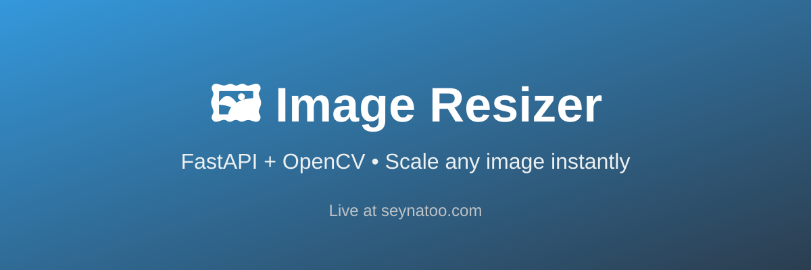

# 🖼️ Image Resizer



A simple, fast, and free **Image Resizer** web application + API.  
Upload an image, choose a scale factor, and download the resized version as a PNG.

**🚀 Live Demo:** [https://seynatoo.com/](https://seynatoo.com/)

Built with **FastAPI** + **OpenCV**, containerized with Docker, and deployed on **Google Cloud Run**.

---

## ✨ Features

- Clean, responsive web interface (no account required)
- Resize any image by a scale factor (`0.1` → `5.0`)
- High-quality resizing using OpenCV (`INTER_AREA`)
- Always returns a PNG
- Simple REST API for programmatic use
- API key protection for external clients (browser usage is unrestricted)
- Lightweight Docker image ready for Cloud Run / any container platform
- Fast cold starts


---

## 🛠️ Tech Stack

| Layer          | Technology                     |
|----------------|--------------------------------|
| Backend        | Python 3.11, FastAPI, Uvicorn  |
| Image Processing | OpenCV (headless), NumPy, Pillow |
| Frontend       | Vanilla HTML / CSS / JS        |
| Container      | Docker                         |
| Hosting        | Google Cloud Run               |

---

## 🚀 Quick Start

### Option 1: Docker (Recommended)

```bash
# Clone the repository
git clone https://github.com/YOUR_USERNAME/image-resizer-api.git
cd image-resizer-api

# Build the image
docker build -t image-resizer .

# Run it
docker run -p 8080:8080 -e API_KEY=my-secret-key image-resizer
```

Open [http://localhost:8080](http://localhost:8080)

### Option 2: Local Python

```bash
# Create virtual environment (optional but recommended)
python -m venv venv
source venv/bin/activate  # On Windows: venv\Scripts\activate

# Install dependencies
pip install -r requirements.txt

# Run the server
export API_KEY=my-secret-key
uvicorn app.main:app --host 0.0.0.0 --port 8080 --reload
```

---

## 📡 API Usage

### Web Interface
Just visit the root URL (`/` or the live demo) and use the form. No API key needed.

### Programmatic Access

**Endpoint:** `POST /resize`

**Headers:**
- `X-API-Key`: Your API key (required for non-browser clients)

**Form Data:**
- `file`: The image file (required)
- `scale`: Scale factor as a float, e.g. `0.5` for half size (required, between 0.1 and 5.0)

#### Example with cURL

```bash
curl -X POST "https://seynatoo.com/resize" \
  -H "X-API-Key: your-secret-key" \
  -F "file=@photo.jpg" \
  -F "scale=0.5" \
  --output resized.png
```

#### Example with Python (requests)

```python
import requests

url = "https://seynatoo.com/resize"
headers = {"X-API-Key": "your-secret-key"}
files = {"file": open("photo.jpg", "rb")}
data = {"scale": 0.33}

response = requests.post(url, headers=headers, files=files, data=data)

if response.status_code == 200:
    with open("resized.png", "wb") as f:
        f.write(response.content)
    print("Success!")
else:
    print(response.json())
```

> **Note:** The live demo currently uses an API key set as an environment variable on Cloud Run. For public use of the API, contact the owner or deploy your own instance.

---

## 🔐 Authentication

- **Browser users** visiting the website directly are allowed without an API key (detected via `Sec-Fetch-Mode` and User-Agent).
- **API clients** must send a valid `X-API-Key` header.
- The API key is read from the `API_KEY` environment variable.

---

## 📁 Project Structure

```
.
├── Dockerfile
├── requirements.txt
├── README.md
└── app/
    └── main.py          # FastAPI application + embedded frontend
```

---

## ☁️ Deploy to Google Cloud Run

```bash
# Build and push to Artifact Registry (or use gcloud builds submit)
gcloud builds submit --tag gcr.io/YOUR_PROJECT_ID/image-resizer

# Deploy
gcloud run deploy image-resizer \
  --image gcr.io/YOUR_PROJECT_ID/image-resizer \
  --platform managed \
  --region us-central1 \
  --allow-unauthenticated \
  --set-env-vars API_KEY=your-secret-key
```

The container listens on the `PORT` environment variable (automatically provided by Cloud Run).

---

## 📝 Environment Variables

| Variable   | Description                              | Default     |
|------------|------------------------------------------|-------------|
| `API_KEY`  | Secret key for API access                | *required*  |
| `PORT`     | Port to listen on                        | `8080`      |

---

## 🤝 Contributing

Contributions are welcome! Feel free to:

- Improve the frontend design
- Add more resize options (exact width/height, quality, format conversion)
- Add batch processing
- Improve error handling
- Add tests

1. Fork the repo
2. Create your feature branch (`git checkout -b feature/AmazingFeature`)
3. Commit your changes
4. Push to the branch
5. Open a Pull Request

